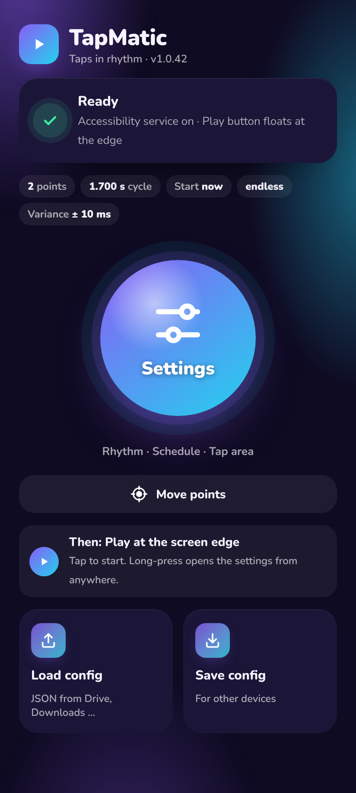
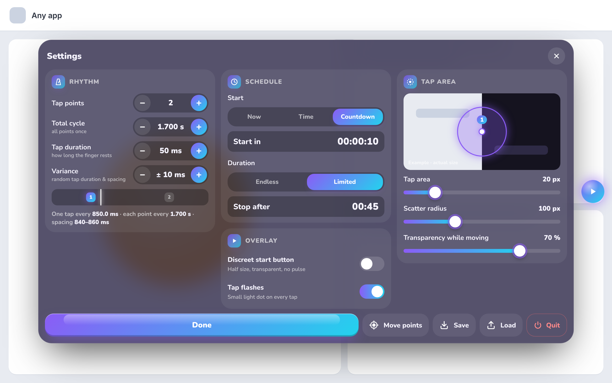
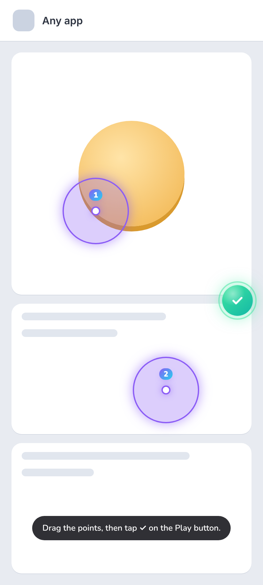
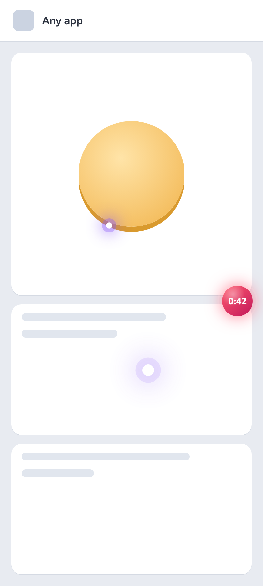

# TapMatic

A small, ad-free auto-tapper for Android. Place tap points anywhere on the screen, set a rhythm, and TapMatic taps them in turn – with optional random variance, a scatter radius and a schedule.

No ads, no tracking, no internet permission.

**[⬇ Download the latest APK](../../releases/latest)**

<table><tr>
<td align="center"> Home</td>
<td align="center"> Settings</td>
<td align="center"> Move points</td>
<td align="center"> Running</td>
</tr></table>

Images are illustrations of the app UI.

## Features

- **Tap points** – 1 to 30 points, freely placed by dragging, tapped in turn
- **Rhythm** – total cycle with millisecond precision (e.g. `1.700 s`), tap duration, and **variance** (± ms) for a natural rhythm
- **Tap area** – each tap lands at a random spot inside a scatter radius; the "finger" covers a small area instead of a single pixel
- **Schedule** – start now, at a time of day, or after a countdown; run endlessly or for a fixed duration
- **Floating Play button** – countdown and remaining time inside the button; optional discreet mode
- **Config files** – save and load all settings as JSON, e.g. via Google Drive to move them between devices

Requires Android 8.0 or newer.

## Install

1. Download `TapMatic-1.0.<n>.apk` from [Releases](../../releases/latest) and open it.
2. **Play Protect warning?** Apps installed outside the Play Store that use an accessibility service are often flagged. Tap **More details → Install anyway**. If there is no such option, temporarily turn off *Play Store → profile → Play Protect → ⚙ → Scan apps with Play Protect*, install, then turn it back on.
   On Xiaomi/MIUI, also turn off the security scan in the package installer (⚙ in the install dialog).
3. **Android 13 and newer** – unlock the accessibility permission once:
   1. Open *Settings → Accessibility → Installed apps → TapMatic* and tap the switch. A "Restricted setting" notice appears – that is expected.
   2. **Long-press the TapMatic icon** on the home screen → **ⓘ App info**. (On some Samsung tablets the ⋮ menu is missing if you open App info through the Settings app.)
   3. Tap **⋮** (top right) → **Allow restricted settings** and confirm with your PIN.
4. In *Settings → Accessibility → TapMatic*, switch it on. The Play button appears at the screen edge.

The app shows these steps with illustrations until the service is enabled.

**Xiaomi/MIUI:** if the Play button disappears after a while, set *App info → Battery saver → No restrictions* and enable *Autostart*.

## Usage

| Action | Result |
|---|---|
| Tap the Play button | Points are shown for 5 s and can be moved, then they hide and tapping starts (or the scheduled countdown) |
| Tap again | Stop |
| Long-press | Settings |
| Drag the button | Move it |
| **Move points** (home screen or settings) | Points stay visible without a time limit; tap the green ✓ to finish |

The screen stays on while TapMatic runs – Android cannot tap while the device sleeps.
To stop TapMatic completely, use **Quit TapMatic** in the app.

## Updates

Download the newer APK and install it over the old one – settings and points are kept.

## Use responsibly

TapMatic only performs the taps you configure. Many games and services forbid automated input in their terms of use – check them before you use TapMatic there.

## License

TapMatic is free to download and use. The source code is not public.
The bundled font [Nunito](https://github.com/googlefonts/nunito) is licensed under the SIL Open Font License 1.1.
